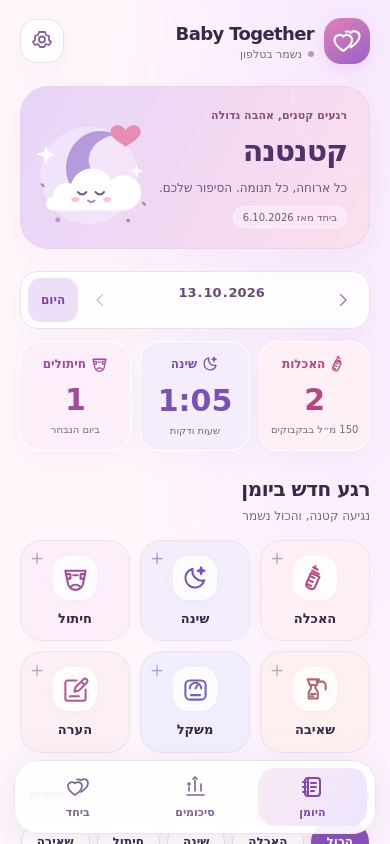
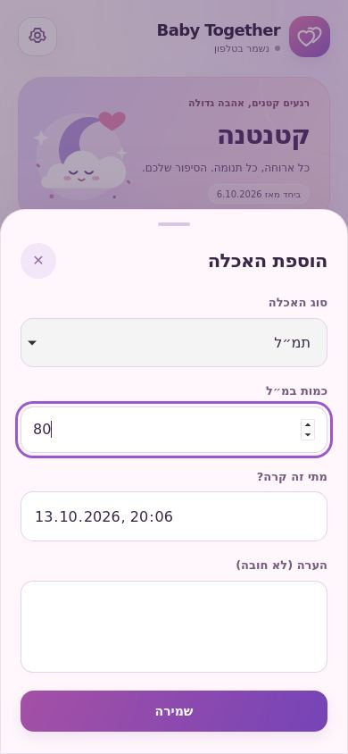
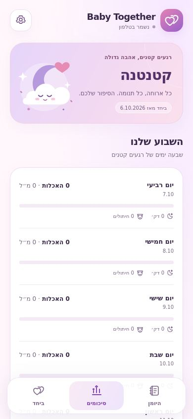
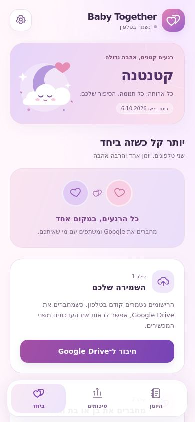

# העיצוב החדש של Baby Together

היומן קיבל צבעי ורוד ולבנדר, כרטיסים רכים, אייקונים חדשים ואיור של ירח וענן. במסך הראשי אפשר לראות את סיכום היום ולהוסיף רישום בלחיצה. מסכי הסיכומים והשיתוף משתמשים באותה שפה חזותית.

האיור זז בעדינות, כפתורים מגיבים ללחיצה וחלון הרישום נפתח מלמטה בטלפון. הגדרת הפחתת התנועה של המכשיר מכבה את האנימציות.

## הצצה למסכים

אלה צילומים מהממשק בפועל, עם נתוני בדיקה בלבד. פרטי התינוקת והרישומים שבתמונות אינם נתונים של המשפחה.

| היומן | הוספת האכלה |
| --- | --- |
|  |  |

| סיכום שבועי | שיתוף ושמירה |
| --- | --- |
|  |  |

## אימות

- [בדיקות הממשק](https://github.com/nbiton93/baby-together/actions/runs/38435828923): Chromium ו-WebKit, עברית מימין לשמאל, רוחבי 320, 390 ו-768 פיקסלים, שמירת האכלה וטעינה מחדש, טיימר שינה, מסכי הסיכומים והשיתוף והפחתת תנועה.
- תצוגת השינה בשעות ודקות נשארת בשורה אחת במסך צר. הודעת השמירה משתמשת במחלקת CSS ותואמת למדיניות התוכן המחמירה של האפליקציה. הבדיקה מזהה בנפרד שתי חסימות צפויות ב-WebKit: סגנון ריק שמנסה להוסיף כלי הצילום, וסגנון ירושה פנימי של בורר הבחירה. אלה זוהו מול קוד המקור ובדיקה מבודדת; ההרשאות במדיניות התוכן של האפליקציה לא הורחבו.
- [בנייה ובדיקות למכשירים](https://github.com/nbiton93/baby-together/actions/runs/38434612580): לוגיקה, Android ולינט, בדיקת יומן באמולטור Android 16 ובניות iOS לסימולטור ולמכשיר.
- בדיקת הממשק משתמשת בתחליף מקומי לגשר המכשיר. היא אינה מבצעת התחברות ל-Google, והצלחת WebKit אינה בדיקה של iPhone פיזי.

## התקנת העדכון

העיצוב נמצא בקוד של שני המכשירים. קובץ Android 0.2.0 שנמסר לפני שינוי העיצוב אינו כולל אותו; העדכון דורש חתימה במפתח Android הקבוע. התקנת iPhone דורשת חתימת Apple, כמתואר ב-[הוראות לאייפון](IPHONE_INSTALL.md).

צילומי המסך סטטיים. אפשר להוריד את כל צילומי Chromium ו-WebKit מתוך תוצרי בדיקות הממשק.
